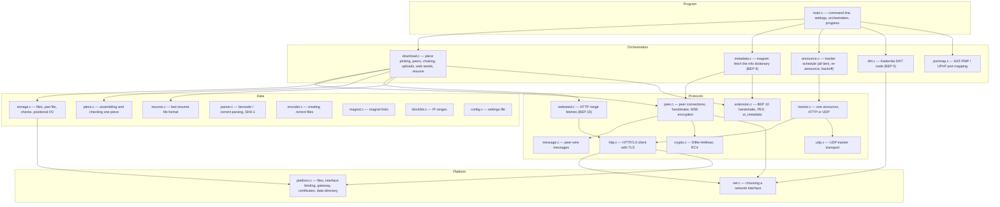
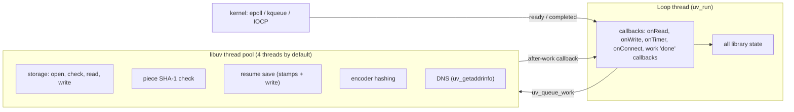
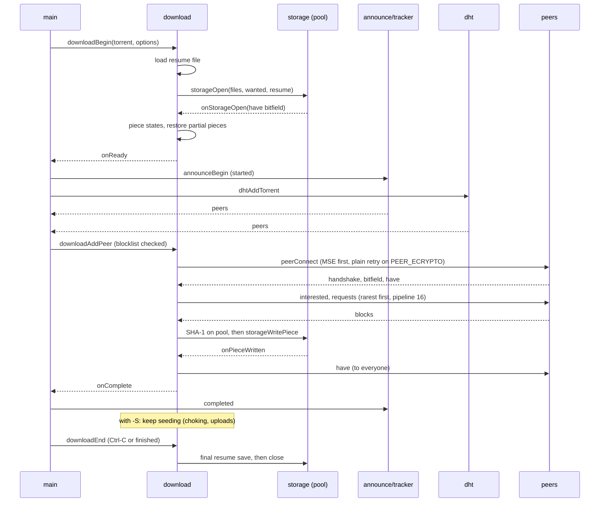
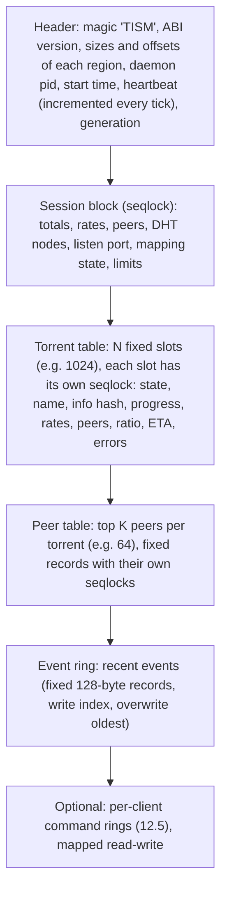

# torrentinfo — Architecture

*13 November 2026. Covers the state of the code at the time of writing:
about 27,000 lines of C99 in `src/` (23 library modules plus `main.c`).*

This document describes how the library and the `torrentinfo` program are
put together. It covers:

- how asynchronous I/O is done with libuv;
- how memory and object lifetimes are managed;
- how a download flows through the modules;
- how Windows differs from Linux (and FreeBSD and macOS);
- the order in which features were added;
- where the project could go next, with a detailed design for a
  long-running service (daemon) that shares memory with client programs.

For building see *BUILDING.md*; for using the program see *USAGE.md*.

---

## 1. Overview

`torrentinfo` is a BitTorrent client library (`libtorrentinfo.a`) and a
command-line program built on it. The program can:

- inspect a torrent;
- create one;
- announce to trackers;
- download it, from a `.torrent` file or a magnet link;
- verify it on disk;
- seed it.

The library implements the core protocol and most of the extensions that
current clients use:

- trackers over HTTP, HTTPS and UDP;
- the DHT;
- peer exchange;
- magnet links with metadata exchange;
- protocol encryption;
- web seeds;
- router port mapping;
- fast resume.

### Design rules

These rules have held since the start and explain many of the decisions
below.

| Rule | What it means in practice |
|---|---|
| **C99, portable** | One code base for Linux, FreeBSD, macOS (experimental) and Windows. `stdint.h` types throughout. |
| **Asynchronous, single-threaded API** | Every library call is made on the libuv loop thread. Nothing blocks the loop: disk, hashing and DNS go to libuv's thread pool. |
| **No `malloc`** | All memory comes from the allocator in `parserContext` (`allocator.realloc` / `allocator.free`), so the embedding program controls it. The program's allocator counts live allocations and reports leaks at exit. |
| **Bundled BSD `queue.h`** | Lists (`TAILQ_*`) come from the same 4.4BSD header on every platform. |
| **Naming** | Public functions are the module name plus camelCase (`storageOpen`, `peerConnect`); constants are the module name in capitals (`DOWNLOAD_MAX_PIPELINE`). |
| **Platform code in one place** | Operating-system differences live in `platform.c` (and a little in `net.c`, `http.c` and `main.c`). |

### Dependencies

- **libuv:** event loop, sockets, timers, thread pool, DNS, signals,
  randomness.
- **OpenSSL 3:** TLS for HTTPS trackers and web seeds, SHA-1, and the
  big-number arithmetic for the encryption key exchange.

Nothing else.

---

## 2. Module map

The library is layered. Lower layers know nothing of the ones above them.

### Modules

| Module | Lines | Responsibility |
|---|---:|---|
| `parser` | 932 | Bencode decoding, `.torrent` parsing into `parserTorrent`, SHA-1, the `parserContext` (allocator). Keeps the raw info dictionary's position for magnet links. |
| `encoder` | 981 | Creating `.torrent` files: walks files, hashes pieces on the thread pool. |
| `message` | 262 | Encoding and decoding peer-wire messages; bitfield helpers. |
| `piece` | 203 | Assembling one piece from 16 KiB blocks, tracking block states, SHA-1 check. |
| `storage` | 1336 | Files on disk: creation, the part file for skipped files, the parallel check of existing data, fast-resume trust, positional reads and writes on the thread pool, a handle cache. |
| `peer` | 1709 | One TCP connection to a peer: handshake, message stream, keep-alives, listening and routing incoming connections, and the MSE/PE encryption layer. |
| `extension` | 442 | BEP 10 extended handshake, peer exchange (BEP 11), metadata messages (BEP 9). |
| `crypto` | 127 | 768-bit Diffie-Hellman (OpenSSL BIGNUM) and RC4. |
| `http` | 1215 | A small HTTP/1.0 client over libuv TCP, with TLS through OpenSSL memory BIOs; GET (with extra headers) and POST. |
| `udp` | 645 | UDP tracker protocol (BEP 15). |
| `tracker` | 944 | One announce to one tracker (HTTP or UDP), results normalised. |
| `announce` | 418 | Keeps every tracker of a torrent announced: tiers, intervals, retries, event `started`/`completed`/`stopped`. |
| `dht` | 1653 | A DHT node: routing table, lookups, `get_peers`/`announce_peer`, tokens, saved state. |
| `metadata` | 696 | Fetching a magnet link's info dictionary from peers. |
| `magnet` | 400 | Parsing magnet links, building a `.torrent` from fetched metadata, making a magnet link from a torrent. |
| `download` | 3345 | The heart: one torrent's download and seeding. Piece selection, request pipelines, endgame, choking, uploads, PEX, web seeds, rate limits, blocklist, fast resume. |
| `webseed` | 474 | Fetching byte ranges of a torrent from an HTTP server. |
| `resume` | 455 | The fast-resume file: encode, seal, write atomically, load and validate. |
| `portmap` | 921 | NAT-PMP and UPnP IGD port mapping. |
| `blocklist` | 588 | Parsing IP blocklists into sorted ranges; binary-search lookup. |
| `config` | 569 | The `key = value` settings file. |
| `net` | 441 | Resolving `-I` (an interface name or address) into a binding applied to every socket. |
| `platform` | 936 | Everything that differs by operating system (section 8). |
| `main` | 3598 | The program: options, settings, and wiring the modules together for each mode. |

---

## 3. Asynchronous I/O with libuv

### 3.1 The model

Everything runs on **one libuv loop on one thread**. The library never
creates threads of its own and never blocks that thread. Work that would
block is done in one of two ways:

1. **Non-blocking I/O on the loop.** Sockets (TCP and UDP), timers and
   signals are libuv *handles*. libuv waits for all of them at once with
   epoll (Linux), kqueue (FreeBSD, macOS) or an I/O completion port
   (Windows), and calls back on the loop thread when something happens.
2. **The thread pool for blocking or CPU-heavy work.** Disk reads and
   writes, SHA-1 hashing of pieces, creating torrents, and DNS lookups
   are submitted with `uv_queue_work()` (or `uv_getaddrinfo()`, which uses
   the same pool). The work function runs on a pool thread; its
   completion callback runs back on the loop thread.

This keeps the library free of locks almost everywhere. All shared state
is touched only on the loop thread. The few exceptions are spelled out in
section 4.

### 3.2 What uses which libuv feature

| libuv feature | Used by | For |
|---|---|---|
| `uv_tcp_t` | `peer`, `http` | Peer connections (outgoing and listening), HTTP(S) trackers and web seeds, UPnP control. |
| `uv_udp_t` | `udp`, `dht`, `portmap` | UDP trackers, DHT messages, NAT-PMP and SSDP discovery. |
| `uv_timer_t` | almost every module | Handshake timeouts, keep-alives (peer: 15 s tick), the download's 100 ms tick (rate limits) and 1 s logic, re-announces, DHT upkeep, retries with backoff, mapping renewals. |
| `uv_queue_work` | `storage`, `download`, `encoder` | Disk I/O, the parallel check of existing data (4 jobs), per-piece SHA-1 checks, resume saves, hashing new torrents. |
| `uv_getaddrinfo` | `http`, `udp`, `dht` | Tracker host names and DHT bootstrap routers. |
| `uv_signal_t` | `main` | Ctrl-C (SIGINT) and SIGTERM: a clean stop (tell trackers, save resume data, remove the port mapping). |
| `uv_random` | `crypto`, `dht`, `download`, `udp`, `tracker`, `main` | Keys, peer ids, transaction ids, tokens, randomised choices. |
| `uv_interface_addresses`, `uv_os_homedir`, `uv_os_getenv` | `net`, `platform` | Interface discovery and data-directory location. |

### 3.3 Reading and writing sockets

**Reading.** A peer connection owns one receive buffer. `onAlloc` hands
libuv the free tail of that buffer, so bytes land where they will be
parsed, without a copy. `onRead` then does three things:

- decrypts the new bytes in place if RC4 is active;
- runs the handshake or encryption state machine, or the message parser;
- compacts the buffer.

A zero-length buffer, given only when the buffer is full, makes libuv
report `UV_ENOBUFS`, which closes the connection; this caps memory per
peer. The buffer grows to fit the largest message allowed (a 128 KiB
block, or the torrent's bitfield).

**Writing.** `uv_write` needs its buffer to stay valid until its
callback, so each outgoing message is copied into a `peerWrite` chunk,
which the write callback frees. Messages are encrypted as they are queued,
so the RC4 key stream stays in step with the order on the wire. Two
signals regulate uploading:

- `uv_stream_get_write_queue_size()` reports how much is still queued; it
  appears as `peerRemoteState.sendQueued`.
- `onDrain` fires when the queue empties.

Together they let uploads wait for the socket rather than pile up memory.

**TLS.** OpenSSL never touches a socket. `http.c` connects the SSL object
to two memory BIOs: bytes read from the libuv TCP handle are written into
the input BIO, and whatever OpenSSL produces in the output BIO is sent
with `uv_write`. The TLS handshake and record layer therefore run on the
loop like any other protocol. Trusted certificates are loaded into memory
once at start-up, so a handshake never reads files on the loop thread.

### 3.4 Timers as schedulers

Several modules are driven by a single repeating timer per object rather
than many one-shot timers.

**The download's timer** ticks every **100 ms**:

- refills the speed-limit token buckets;
- lets uploads and requests through, round-robin between peers;
- starts web-seed fetches.

Every **10th tick (1 s)** it also:

- checks for stalled peers;
- rechokes every 10 s, with an optimistic unchoke every 30 s;
- sends PEX every 60 s per peer;
- saves resume data every 30 s;
- reconnects queued peers;
- detects "no data" and "no peers" conditions.

**A peer connection's timer** has two roles:

- the handshake timeout at first;
- after the handshake, a 15 s tick that sends keep-alives after 90 s of
  silence from our side and drops peers silent for 180 s.

### 3.5 The thread pool in detail

| Job | Submitted from | Pool thread does | Completion does |
|---|---|---|---|
| Open storage | `storageOpen` | Create directories, stat (with time stamps for fast resume), create or resize files, read the part-file index | Settle pieces from resume data; start checks or report ready |
| Check existing data | `startChecks` (4 jobs, each a slice of pieces) | Read and SHA-1 every piece that lies in existing, untrusted data | Merge results into the `have` bitfield; report ready |
| Verify a downloaded piece | `completePiece` | SHA-1 of the assembled piece | Write it, or blame the senders and fetch it again |
| Write a piece | `storageWritePiece` | `pwrite` / `WriteFile` across the files the piece spans (and the part file) | Mark on disk, send `have` to peers, mark resume data dirty |
| Read a block | `storageReadBlock` (uploads) | `pread` / `ReadFile` | Send the block to the peer |
| Save resume data | `resumeStartSave` | Stat the files, stamp and checksum the encoded file, write `.tmp`, rename over the old file | Close storage if it was waiting; start the final save if one is pending |
| Hash a new torrent | `encoder` | Read and hash the input files | Build the `.torrent` |

The pool is shared by all of these and by DNS. Its default size is 4
threads, which can be changed with the `UV_THREADPOOL_SIZE` environment
variable before the first use. A daemon handling many torrents would want
more, or would want disk work to have its own queue (section 11).

### 3.6 Lifetimes: closing things safely

libuv closes handles asynchronously: `uv_close()` returns at once, and the
close callback runs later. Pool work may also complete after its owner has
been told to stop. Every module that owns handles or jobs follows the same
pattern.

- **A pending count.** `peer.c` counts libuv callbacks still to come (open
  handles plus writes in flight). `storage.c` counts pool jobs.
  `download.c` waits for its timer to close, for piece checks
  (`verifyJobs`) and for resume saves (`saveJobs`). `dht.c` waits for its
  handles and outstanding DNS requests (`finalRelease`).
- **Closed or ended flags.** After the user calls `peerClose()`,
  `storageClose()`, `downloadEnd()` and so on, no further user callbacks
  are made. Late completions see the flag and only release memory.
- **Free last.** An object is freed only when it has been closed and its
  pending count is zero, typically in whichever callback brings the count
  to zero.
- **Re-entrancy.** User callbacks may call the module's own close
  function. Guards such as `inCallback` (peer) and "the job still counts
  while its callback runs" (storage) stop the object being freed under the
  code that called back.
- **Ordered shutdown.** The final fast-resume save needs the storage, so
  `closeStore()` defers `storageClose()` until the save completes. Ending
  a download is then:
  1. `downloadEnd()` starts the final save and closes the listeners, peers
     and timer;
  2. the save completes;
  3. the storage closes;
  4. the last outstanding callback frees the download.

`main.c` keeps calling `uv_run()` until the loop has nothing left, which
is how it waits for all of this. Its leak counter then confirms that
nothing was missed.

---

## 4. Memory and ownership

**One allocator.** Every module allocates through
`context->allocator.realloc(NULL, size)` and `context->allocator.free(p)`.
Nothing calls `malloc` directly. The program installs a counting allocator
(`trackingRealloc`) that reports leaks at exit. That is cheap and has
caught real bugs.

The exceptions are the external libraries:

- libuv allocates internally;
- OpenSSL allocates internally, for TLS and for `BIGNUM`s;
- `fopen` allocates (used only for `/proc/net/route` on Linux).

**The allocator is not thread-safe**: the counter is a plain variable. So
pool threads never allocate or free. Everything a job needs is allocated
on the loop thread before `uv_queue_work`, and freed in the completion
callback:

- `storage.c` prepares paths, the hash table copy, scratch buffers and
  the part-file slot map up front.
- A new part-file record is assigned on the loop thread before the write
  is queued.
- Resume saving is split in three for this reason:
  - `resumeEncode` allocates and encodes on the loop thread;
  - `resumeSeal` adds the stamps and checksum on the pool;
  - `resumeWrite` writes the file on the pool.
  The last two allocate nothing.

**Ownership hand-offs** are explicit in the APIs:

- `storageWritePiece` takes ownership of the piece buffer and frees it
  whatever the outcome.
- `storageReadBlock` takes the buffer and hands it back through the
  callback.
- `pieceTakeData` transfers the assembled buffer out of a piece.

**Shared state across threads** is limited to:

- `storage`'s mutex-protected file-handle cache (up to 64 handles, opened
  on demand by pool threads);
- check-progress counters and the "stop checking" flag.

Positional I/O (`pread`/`pwrite`, or `ReadFile`/`WriteFile` with an offset)
means one cached handle can serve several threads at once without a
shared file position. Different jobs never touch the same bytes, because
pieces don't overlap.

---

## 5. Life of a download

### 5.1 Steps in more detail

1. **Starting.** `main` parses the torrent, or for a magnet link runs
   `metadata` first: it fetches the info dictionary from peers, checks it
   against the info hash and caches it. It also:
   - loads the settings file and the blocklist;
   - sets the encryption policy;
   - computes the file selection (`-f`/`-F`) and the resume file's path;
   - calls `downloadBegin`.
2. **Opening storage.** On the pool, the files are created or resized,
   and each file's size and time are compared with the resume file. Only
   pieces in changed or unknown data are hashed, in 4 parallel jobs. Back
   on the loop, each piece becomes *done*, *needed* or *not wanted*.
   Unfinished pieces saved at the last stop are restored with their
   blocks.
3. **Finding peers.** Four sources feed `downloadAddPeer`:
   - `announce` (every tracker, every tier);
   - the DHT;
   - peer exchange from connected peers;
   - incoming connections.
   The blocklist is checked first. Addresses are queued and connected up
   to `maxPeers` (50 by default). Failed or dropped peers are retried with
   backoff.
4. **Connecting.** `peerConnect` starts with the encrypted handshake
   unless encryption is off. If the peer drops it (`PEER_ECRYPTO`), the
   download retries at once without encryption. After the BitTorrent
   handshake come the bitfield and the BEP 10 extended handshake (PEX,
   metadata).
5. **Requesting.** `requestOne` picks work for each peer in this order:
   1. its own pieces;
   2. orphaned pieces (no current peer, e.g. restored from resume);
   3. a new piece, rarest first;
   4. help with other peers' pieces;
   5. in the endgame, duplicate requests for blocks outstanding for more
      than 1.5 s.

   Pipelines hold 16 requests per peer by default. Under a download limit,
   requests are charged to a token bucket and shared round-robin.
6. **Web seeds** take runs of consecutive needed pieces (about 4 MiB,
   smaller near the end or after a failure). They fetch them with HTTP
   `Range` requests and hand each piece to the same checking path.
7. **Checking and writing.** A complete piece is hashed on the pool.
   - **Good:** it is written (pool) and announced with `have` to every
     peer.
   - **Bad:** the senders are worked out. A sole sender is excluded. With
     several senders the failed copy is kept, and when a good copy
     arrives, the differing blocks identify the culprit. A web seed is
     dropped after two corrupt pieces.
8. **Uploading and choking.** Uploads go to 4 peers at a time: the 3 that
   send to us fastest (or, when seeding, take from us fastest), plus one
   optimistic unchoke rotated every 30 s. Requests are queued per peer,
   read from disk on the pool, and sent as the socket drains, within the
   upload limit.
9. **Finishing.** When every wanted piece is on disk:
   - trackers are told `completed`;
   - with `-S` the download keeps seeding, dropping peers that are also
     complete;
   - otherwise it ends.

   On any end (finish, Ctrl-C, error) the final resume save runs, trackers
   are told `stopped`, the port mapping is removed and the DHT routing
   table is saved.

---

## 6. Storage and disk I/O

**Layout.** A single-file torrent is `<dir>/<name>`; a multi-file one is
`<dir>/<name>/<path...>`. BEP 47 padding files are never stored: they read
as zeros and writes to them are skipped. On Windows, characters and device
names that Windows forbids are adjusted (`_` replacements, `CON` →
`_CON`).

**Positional, piece-wise I/O.** `rangeIo()` walks the files that a byte
range touches, found by binary search on file offsets, and reads or writes
each slice at its offset.

**Skipped files and the part file.**
- Files not chosen with `-f`/`-F` are not created.
- A wanted piece that also covers a skipped file is still downloaded,
  since it can't be checked otherwise. The skipped part is kept in
  `<dir>/.<name>.parts`, a file of records: an 8-byte header (`TIP1` plus
  the piece index) and a piece's worth of space.
- `partSlot[]` maps pieces to records. It is read when storage opens and
  extended on the loop thread before a write is queued.
- The part file is deleted once every file is on disk.

**Checking existing data** runs on 4 pool jobs, each covering a slice of
the pieces. Progress (pieces checked so far) is shared under the storage
mutex, so the program can report it every 2 s.

**Fast resume** (`resume.c`):
- **What is saved:** `resume/<info hash>.resume` records the pieces on
  disk, every file's size and modification time and, at the final save,
  the received blocks of unfinished pieces (up to 64 MiB).
- **Safety:** the file ends with a SHA-1 of its contents and is replaced
  atomically (`.tmp` plus `rename`/`MoveFileExW`).
- **On open:** files whose stamps still match are trusted, and their
  pieces are settled without reading.
- **Ordering:** the bitfield is taken before the files are stamped. A
  write landing in between can only make a piece look missing (fetched
  again) or a file look changed (checked again), never the reverse.

**Handle cache.** Up to 64 files stay open, opened on demand by pool
threads under the mutex. Beyond that, temporary handles are opened and
closed per operation.

---

## 7. Networking

### 7.1 Peers (`peer.c`, `message.c`, `extension.c`)

- **Handshake.** The 68-byte BitTorrent handshake is checked as it
  arrives, so a non-BitTorrent server fails fast. Reserved bits advertise
  BEP 10.
- **Validation.** Messages are checked before being applied: block
  sizes, piece indices, and the bitfield arriving before other core
  messages (extended messages may come first).
- **Incoming connections** are routed by info hash to whichever listener
  callback accepts them. A download listens on its port (the next free
  one of 10) for IPv4 and IPv6.
- **Encryption (MSE/PE).** A layer below the handshake:
  - Diffie-Hellman over the 768-bit MSE prime, then RC4 with the first
    1024 bytes of key stream discarded;
  - "plaintext after the handshake" is supported;
  - incoming connections are recognised by their first 20 bytes, and the
    torrent is found by trying each of the listener's info hashes against
    `SHA1("req2", hash) xor SHA1("req3", S)`;
  - policy is off / prefer / require, with an immediate plain retry under
    *prefer*.

### 7.2 Trackers (`announce.c`, `tracker.c`, `http.c`, `udp.c`)

- All tiers are announced at once.
- Each tracker is re-announced at its own interval (clamped to 60 s–1 h),
  with real `uploaded`/`downloaded`/`left` figures.
- Failures are retried with backoff.
- `stopped` is sent at the end, waiting at most a few seconds.
- HTTP trackers use `http.c` (TLS for HTTPS); UDP trackers use BEP 15
  connection ids and transactions.

### 7.3 DHT (`dht.c`)

- A BEP 5 node: 160 buckets of 8, lookups with 4 queries in flight,
  `get_peers` and `announce_peer`.
- Tokens are SHA-1 of a rotating secret and the requester's IP.
- Peers announced to us are stored, up to 256 torrents of 64 peers each.
- The routing table is saved to `dht.dat` between runs, and new nodes are
  pinged before being trusted.
- Private torrents never use the DHT. IPv4 only so far.

### 7.4 Other sources and services

- **Peer exchange (BEP 11):** every 60 s per peer, first after 10 s; not
  for private torrents.
- **Metadata (BEP 9):** fetched for magnet links and served to others.
- **Web seeds (BEP 19):** `webseed.c` maps torrent byte ranges to
  per-file `Range` requests and follows redirects. It accepts a whole-file
  reply from servers without range support, for files up to 16 MiB.
- **Port mapping:** NAT-PMP to the default gateway first, then UPnP.
  Mappings are renewed before expiry and removed at exit.
- **Interface binding (`-I`):** every socket is bound to the interface's
  address and, where the operating system allows, tied to the interface
  itself (section 8).
- **Limits:** token buckets for download (charged per request) and
  upload (charged per block read). Uploads are shared by
  "least recently served".
- **Blocklist:** sorted, merged ranges, looked up by binary search.
  Applied to every peer source, incoming connections and DHT nodes.

---

## 8. Platform differences

libuv hides most differences between operating systems, but not all.
What remains is in `platform.c`, with smaller parts in `net.c`, `http.c`
and `main.c`.

### 8.1 Windows compared with Linux

| Area | Linux | Windows | Notes |
|---|---|---|---|
| **libuv backend** | `epoll`: the kernel says a socket is *ready*, libuv then reads or writes. | I/O completion ports: libuv starts an overlapped operation and is told when it *has completed*. | Invisible to the library: the same `onAlloc`/`onRead`/`uv_write` code works with both. The write buffer must stay valid until the callback either way, which `peerWrite` ensures. |
| **Socket handle** | `uv_fileno` gives an `int` descriptor. | It gives a `HANDLE`, which for sockets holds the `SOCKET`. | `NET_SOCKET()` in `net.c` converts. |
| **File I/O** | `open`, `pread`, `pwrite`, `ftruncate`, `fstat`. | `CreateFileW`, `ReadFile`/`WriteFile` with an `OVERLAPPED` offset (on a synchronous handle), `SetEndOfFile`, `GetFileInformationByHandle`. | Both are positional and safe from several threads. |
| **Paths** | UTF-8 bytes, passed straight through. | UTF-8 converted to UTF-16 for every `…W` call (on the stack: up to 32,768 units). | Reserved device names and forbidden characters are adjusted when a torrent's paths are built. |
| **Command line and console** | UTF-8 already. | Arguments re-read with `CommandLineToArgvW` and converted to UTF-8; console output set to `CP_UTF8`; the manifest declares UTF-8 as the code page. | Non-ASCII torrent names work on both. |
| **File times (fast resume)** | `stat()` `st_mtim`, nanoseconds since 1970. | `GetFileTime()`, 100 ns units since 1601. | Only compared with each other, never converted. |
| **Atomic replace** | `rename()`. | `MoveFileExW(…REPLACE_EXISTING \| WRITE_THROUGH)`. | Used for resume files. |
| **Tying a socket to an interface** | `SO_BINDTODEVICE` with the name (needs `CAP_NET_RAW` before Linux 5.7; otherwise falls back to address-only binding with a warning). | `IP_UNICAST_IF` / `IPV6_UNICAST_IF` with the interface index. The IPv4 index must be in network byte order, the IPv6 one in host order. | Interface names: `tun0`, `eth0` vs "friendly" names such as `Ethernet 2`, mapped through the LUID. |
| **Default gateway** | Parse `/proc/net/route`. | `GetIpForwardTable()` into a caller-supplied buffer. | `platformDefaultGateway()` never allocates; the caller grows the buffer on `UV_ENOBUFS`. |
| **Trusted CA certificates** | PEM bundles from the usual distribution paths, after `SSL_CERT_FILE` and OpenSSL's default. | Every certificate in the system "ROOT" store copied into OpenSSL's in-memory store at start-up. | `-C file.pem` overrides both. |
| **Signals** | `SIGINT`, `SIGTERM` via `uv_signal`; `SIGPIPE` ignored so a closed peer gives a write error instead of killing the process. | libuv turns Ctrl-C (console control events) into `SIGINT`. There is no `SIGPIPE`. | |
| **Data directory** | `~/.torrentinfo` | `%APPDATA%\torrentinfo` | |
| **Sparse files** | `ftruncate` to full size makes a sparse file; unwritten ranges cost nothing. | `SetEndOfFile` sets the size, but writing far beyond the "valid data length" makes NTFS zero-fill the gap first, so the first writes into a large new file can be slow. | A known difference; marking files sparse (`FSCTL_SET_SPARSE`) is on the future list. |
| **Timers** | Millisecond resolution. | The system clock tick (about 15.6 ms by default). | The 100 ms rate-limit tick is a little coarser on Windows; limits still average correctly. |
| **Build** | `make -f Makefile-Linux`; libuv and OpenSSL from the distribution, found with pkg-config; `-D_POSIX_C_SOURCE=200809L`. | Visual Studio 2026 (toolset v145); libuv and OpenSSL through vcpkg manifest mode; `WIN32_LEAN_AND_MEAN`. Also cross-built with MinGW-w64 and tested under Wine. | |

### 8.2 FreeBSD and macOS

| Area | FreeBSD | macOS (experimental) |
|---|---|---|
| libuv backend | kqueue | kqueue |
| Feature macros | No global `_POSIX_C_SOURCE` (it would hide BSD interfaces); `platform.c` skips it. | `-D_DARWIN_C_SOURCE`; `platform.c` skips `_POSIX_C_SOURCE`. |
| Tying sockets to an interface | Not possible: address-only binding (reported as `[address only]`; `setfib` is the workaround). | `IP_BOUND_IF` / `IPV6_BOUND_IF` by index: full binding. |
| Default gateway | Routing sysctl `NET_RT_FLAGS`/`RTF_GATEWAY`; addresses padded with `SA_SIZE` (8 bytes). | The same sysctl; addresses padded to 4 bytes. |
| File times | `st_mtim` | `st_mtimespec` |
| Certificates | `/etc/ssl/cert.pem` (base), `ca_root_nss`, packaged OpenSSL. | Homebrew `openssl@3` and `ca-certificates` copies, MacPorts, then `/etc/ssl/cert.pem` (the Keychain is not readable by OpenSSL). |
| Data directory | `~/.torrentinfo` | `~/Library/Application Support/torrentinfo` |
| Build | `make -f Makefile-FreeBSD` (bmake); libuv from packages, OpenSSL from base. | `make -f Makefile-macOS` (GNU make 3.81); Homebrew libuv, `openssl@3`, pkg-config. |
| Verified | Compiled against FreeBSD's headers (amd64 and arm64); library built with bmake. Not yet run. | Compiled against Apple's open-source headers (arm64 and x86_64) with a few stand-ins; objects and library built. Not yet linked or run. |

---

## 9. Feature history

Features were added in this order. The first group is the foundation the
project started from; the numbered list follows the order of development
since then.

**Foundations**
- Bencode and `.torrent` parsing with the info-hash calculation, and the
  `torrentinfo file.torrent` inspector.
- Creating torrents (`-o`), with hashing on the thread pool.
- Tracker announces over HTTP, HTTPS (OpenSSL) and UDP (`-t`).
- Probing peers (`-P`).
- The peer-wire protocol, piece assembly and storage.
- Downloading a single piece (`-i`).
- Building on both Linux and Windows (Visual Studio project) from the
  start.

**Since then**

1. **Multi-peer download (`-D`):**
   - rarest-first piece picking and request pipelines;
   - endgame with a 1.5 s delay before duplicating requests;
   - blame for corrupt pieces;
   - `SIGPIPE` handling.
2. **Verify (`-V`):** per-file status, percentage, bytes, missing pieces;
   exit status 2 when incomplete.
3. **Source layout:** sources moved to `src/`; `.gitignore`.
4. **Interface binding (`-I`):** `SO_BINDTODEVICE` / `IP_UNICAST_IF`;
   `net.c`.
5. **Trackers and seeding:**
   - re-announcing with real statistics;
   - uploading and seeding (`-S`);
   - choking with 3 regular slots plus 1 optimistic, rechoke every 10 s;
   - accepting incoming peers.
6. **USAGE.md**, written as a manual page.
7. **Peer exchange (BEP 10/11) and port mapping** (NAT-PMP, UPnP).
   - Compatibility fix: peers that send extended messages before the
     bitfield.
8. **Build output under `build/linux`**, so `clean` leaves a Windows
   build alone.
9. **Performance:** SHA-1 checks on the thread pool, a parallel check of
   existing data (4 jobs), a file-handle cache with positional I/O.
10. **Magnet links (BEP 9) and the DHT (BEP 5):**
    - the data directory (`~/.torrentinfo`, `%APPDATA%\torrentinfo`);
    - metadata cache, DHT state, retries;
    - hints for private torrents.
11. **Magnet link from a torrent (`-m`).**
12. **Settings file and IP blocklist:** `config.c`, `blocklist.c`
    (P2P, ipfilter.dat and CIDR formats).
13. **Speed limits (`-d`, `-u`):** token buckets; fair sharing between
    peers.
14. **Choosing files (`-f`, `-F`):** skipped files are not created; the
    part file holds the edges of pieces shared with them.
15. **Protocol encryption (MSE/PE, `-E`):** `crypto.c` and the layer in
    `peer.c`; interop with libtorrent in both directions.
16. **Web seeds (BEP 19, `-W`):** `webseed.c`, range requests and
    redirects.
17. **FreeBSD support:**
    - the platform layer gained interface tying, gateway lookup and
      certificate locations;
    - `Makefile-Linux` and `Makefile-FreeBSD`.
18. **Fast resume (`-R` to bypass):** `resume.c`, trusted file stamps,
    unfinished pieces kept.
19. **macOS port (experimental):** `Makefile-macOS`, `IP_BOUND_IF`, the
    Darwin routing sysctl, the macOS data directory.

---

## 10. Testing and quality

- **Sanitizers.** Every feature has been run under AddressSanitizer +
  UBSan and under ThreadSanitizer. This includes Ctrl-C at awkward
  moments, failing servers, and hostile input on the listening port.
- **Leak check.** The program's counting allocator fails the run if
  anything is still allocated at exit.
- **Fake servers** (Python) cover:
  - trackers;
  - seeds with scripted misbehaviour: corrupt blocks, stalls,
    out-of-order extended messages, slow or partial peers;
  - a NAT-PMP/UPnP router;
  - an HTTP range server with redirect, no-range, short-reply, corrupt and
    404 modes.
- **Interoperability** with libtorrent 2.1:
  - downloads and uploads;
  - DHT both ways;
  - magnet metadata;
  - encryption forced, disabled and header-only, in both directions.
- **A regression script** runs 24 checks covering every feature against
  those servers and libtorrent. After the macOS changes it passed:
  - on Linux release, ASan/UBSan and TSan builds;
  - on the Windows build under Wine.
- **Cross-platform compile checks:**
  - FreeBSD headers (amd64, arm64) with bmake;
  - Apple's open-source headers (arm64, x86_64);
  - MinGW-w64 for Windows;
  all with `-Wall -Wextra -Wpedantic -Wconversion -Wshadow` and no
  warnings.

---

## 11. Future directions

Roughly in order of value and size.

### 11.1 Protocol and features
- **Seeding limits:** stop at a share ratio or after a time.
- **Sequential download:** pieces in order, for watching media while it
  downloads.
- **The Fast extension (BEP 6):** "have all/none", rejects, allowed-fast
  pieces.
- **uTP (BEP 29):** the UDP transport most clients prefer; gentler on home
  networks, better through NAT.
- **IPv6 DHT (BEP 32)** and the DHT port message.
- **Magnet `xs=`:** fetch the `.torrent` directly from the URL given.
- **BitTorrent v2 (BEP 52):** SHA-256 Merkle trees, per-file hashes, hybrid
  torrents.
- **Local peer discovery (BEP 14)** and **holepunching (BEP 55)**.
- **Scrape (BEP 48)** for swarm statistics without announcing.

### 11.2 Engine
- **Several torrents in one process.** This is the prerequisite for a
  daemon (section 12): a *session* that owns the shared parts.
- **A disk queue separate from the thread pool,** with write coalescing
  and a read cache for seeding, so disk work cannot starve DNS. On Linux,
  `io_uring` through libuv's file operations is an option.
- **Sparse files on Windows** (`FSCTL_SET_SPARSE`), to avoid NTFS
  zero-filling when writing into the middle of new large files.
- **Logging** with levels and a callback, instead of `printf` from `main`.
- **Moving the orchestration out of `main.c`.** Announce, DHT and port
  mapping wiring, progress and stopping would move into the library, so
  that embedders and the daemon get it for free.
- **Live reload** of settings and the blocklist.

### 11.3 Platforms and packaging
- Run and fix the FreeBSD and macOS builds on real machines; a universal
  macOS binary.
- Service integration: systemd units, FreeBSD `rc.d` scripts, a macOS
  `launchd` agent, a Windows service.
- Packages: deb/rpm, a FreeBSD port, a Homebrew formula, an MSI or winget
  package.

---

## 12. Proposed service (daemon) with shared memory

The goal is a long-running `torrentinfod` that manages many torrents.
Client programs — a command-line tool, a terminal dashboard, a GUI, a
script — need to:

- **send commands** with low latency: add, pause, resume, remove, set
  limits;
- **watch** live information and statistics without disturbing the
  daemon.

### 12.1 Recommended shape: two channels

| Channel | Mechanism | Carries | Why |
|---|---|---|---|
| **Control** | A local stream socket: a UNIX domain socket on Linux, FreeBSD and macOS; a named pipe on Windows. Both are `uv_pipe_t` in libuv. | Commands and replies, events, large payloads (a `.torrent` file being added), authentication. | libuv supports both natively, so it plugs into the existing loop with no new platform code. It is ordered and reliable, and gives the daemon a clear signal when a client goes away (EOF). |
| **Data** | Shared memory, mapped read-only by clients. | Live statistics: session, per-torrent and top peers. Optionally fast command rings (12.5). | Clients read numbers at any rate (a 60 fps dashboard costs the daemon nothing). Reads are memory-speed, with no system calls and no message parsing. |

Shared memory alone could carry commands too. But a socket for control
keeps the hard parts simple: authentication, variable-size data, knowing
when a client dies, and waking the daemon. The shared-memory command ring
in 12.5 is an optional fast path for clients that need sub-millisecond
latency.

### 12.2 Changes needed in the library first

1. **A session object** (`session.c`) owning what is shared between
   torrents:
   - the loop;
   - a single listening port, routing incoming connections by info hash.
     This already exists via `peerListenerAddInfoHash`; the fixed limit of
     16 hashes would need to become dynamic.
   - one DHT node (`dhtAddTorrent` already handles many torrents);
   - the port mapping;
   - the blocklist and settings;
   - **global** rate limits and connection limits, by moving `rateLimit`
     up from `download` so one budget is shared fairly across torrents;
   - a torrent list saved in the data directory.
2. **Move orchestration out of `main.c`** (11.2) into the session: per
   torrent announce, DHT registration, start/stop, completion, resume.
3. **A queue manager:** at most N torrents downloading or seeding at once,
   with priorities.
4. **Events** in the library (piece done, peer joined, tracker error) as
   callbacks, so the daemon can publish them instead of `main` printing
   them.

### 12.3 Shared-memory layout

One mapping per daemon, named per user:
- POSIX: `/torrentinfo-<uid>` (macOS limits names to 31 characters);
- Windows: `Local\torrentinfo-<user SID hash>`.

Clients map it read-only.

**Layout rules**
- **Fixed size, fixed offsets:** no pointers, only offsets from the
  start. Every record is a multiple of 64 bytes and aligned to 64 bytes,
  so different records never share a CPU cache line.
- **Strings** (names, error text) live in fixed-size fields in the
  record, truncated with a flag, or in a separate string area indexed by
  offset.
- **Slots are reused:** a torrent keeps its slot until removed. A slot's
  *generation* number changes on reuse, so a client holding slot 17 can
  tell that it now holds a different torrent.
- **Numbers are 64-bit** where they can grow (bytes, counts), so readers
  never see wrap-around.
- **Endianness and layout** are the machine's own; the header carries the
  ABI version and every region's size, and clients refuse a mismatch.

### 12.4 Consistency without locks: seqlocks

The daemon is the only writer and runs on its loop thread, so each record
uses a **sequence lock**.

The writer:
1. increments `seq` (it becomes odd);
2. updates the fields;
3. increments `seq` again (even), with release ordering.

A reader:
1. reads `seq` (acquire);
2. if it is odd, retries;
3. copies the record;
4. reads `seq` again;
5. retries if it changed.

Properties:
- Readers never block the writer, and a crashed or slow client can't
  affect the daemon.
- Updates are cheap: the daemon refreshes torrent records at its 1 s tick
  (or 100 ms for "live" rates), and only records that changed.
- The atomics need C11 `<stdatomic.h>` or compiler intrinsics. The project
  is C99, so this belongs in a small `platform` addition:
  `platformAtomicLoadAcquire`, `platformAtomicStoreRelease` and
  `platformAtomicIncrement`, implemented with `__atomic_*` builtins on
  GCC/clang and `Interlocked*` with `_ReadWriteBarrier` on MSVC.

### 12.5 Low-latency commands through shared memory (optional)

For clients that need commands in microseconds (an automation tool
reacting to events, say):
- **A ring per client.** Each client registers over the control socket
  and is given a slot with **two single-producer, single-consumer rings**:
  commands (client → daemon) and replies (daemon → client).
- **Single-producer, single-consumer** means no locks: each side owns one
  index, and the other side only reads it (acquire/release ordering).
  Records are fixed size (128 bytes): type, request id, torrent slot,
  arguments.
- **Waking the daemon** without polling. The client writes a record, then
  "rings the doorbell", which wakes the libuv loop:
  - **Linux:** an `eventfd`, watched with `uv_poll`;
  - **FreeBSD and macOS:** a pipe, watched with `uv_poll`;
  - **Windows:** a byte on the client's named pipe. libuv cannot wait on
    a Win32 event object directly; the alternative is a helper thread
    blocking in `WaitForMultipleObjects` and calling `uv_async_send`.
- **Batching:** the daemon drains every ring each time it wakes, so many
  commands cost one wake-up.
- **Latency:** with busy-polling enabled for a client (spinning on the
  reply index), round trips of a few microseconds are possible on the same
  machine.
- **Safety:** the daemon **copies a command out of the ring before
  validating it**. Indices, lengths and enum values are checked, and
  unknown types are rejected, so a buggy or hostile client can't corrupt
  daemon state or make it read out of bounds.

### 12.6 Platform layer additions

| Function | POSIX (Linux, FreeBSD, macOS) | Windows |
|---|---|---|
| `platformSharedCreate(name, size)` | `shm_open(O_CREAT\|O_EXCL, 0600)`, `ftruncate`, `mmap`. On macOS the size cannot change after creation, so it is sized once. | `CreateFileMappingW` with a security descriptor for the current user, then `MapViewOfFile`. |
| `platformSharedOpen(name, readOnly)` | `shm_open` + `mmap(PROT_READ)` | `OpenFileMappingW` + `MapViewOfFile(FILE_MAP_READ)` |
| `platformSharedClose` / `Unlink` | `munmap`, `shm_unlink` | `UnmapViewOfFile`, `CloseHandle` (gone when the last user closes it) |
| `platformDoorbell*` | `eventfd` (Linux), `pipe` (BSDs, macOS) | named pipe byte, or event + helper thread |
| Atomics | `__atomic_load_n`, `__atomic_store_n` | `InterlockedCompareExchange`, `_ReadWriteBarrier` |

### 12.7 Security and robustness

- **One daemon per user.** The shared memory, the socket (in
  `$XDG_RUNTIME_DIR` or the data directory) and the pipe are accessible
  only to that user (`0600` permissions; owner-only security descriptor on
  Windows).
- **Clients only read the statistics mapping.** Command rings, if used,
  are per client, so one client can't write into another's.
- **Liveness.** The header's heartbeat lets clients detect a hung or dead
  daemon. The daemon detects dead clients by socket EOF and reclaims their
  ring slots.
- **Restarts.** A new daemon recreates the mapping with a new generation
  in the header, and clients reconnect. The torrent list and resume files
  make restarts cheap: no re-checking.
- **Versioning.** The ABI version and region sizes in the header; adding
  fields at the end of a record, with sizes recorded, keeps old clients
  working.

### 12.8 Running as a service

- **Linux:** a systemd user unit (`Type=notify` through `sd_notify` is
  optional).
- **FreeBSD:** an `rc.d` script.
- **macOS:** a `launchd` agent plist.
- **Windows:** a service with `StartServiceCtrlDispatcher`. The libuv loop
  runs on the service thread, and the stop control calls `uv_async_send`
  to begin a clean shutdown: the same path as Ctrl-C today.

### 12.9 Suggested phases

1. **Session refactor:** many torrents in one process, global limits, one
   listener and one DHT. Still a command-line program.
2. **Daemon and control socket** with a simple request/response protocol
   (length-prefixed binary or JSON), plus a `torrentinfo` client mode
   (`torrentinfo add|list|pause|stats`).
3. **Shared-memory statistics** (12.3–12.4) and a terminal dashboard as
   the first reader.
4. **Optional:** shared-memory command rings with doorbells (12.5) for
   low-latency clients.
5. **Service integration** for each operating system and packaging.

### 12.10 Risks and open questions

- **Torn reads** are prevented by seqlocks only if every field is copied
  inside the read section. Readers must copy, not keep pointers into
  shared memory.
- **Shared-memory size** is fixed at creation. Choose limits (torrents,
  peers per torrent) generously, or support a "remap" generation bump.
- **macOS** restricts POSIX shared-memory names to 31 characters and
  doesn't allow resizing. Sandboxed (App Store) clients would need an App
  Group container instead.
- **Windows** has no `eventfd`, and libuv can't wait on event objects, so
  the doorbell design differs (12.5).
- **Remote access** (another machine) needs the socket protocol over TCP
  with authentication and TLS. Shared memory is local only by nature.
