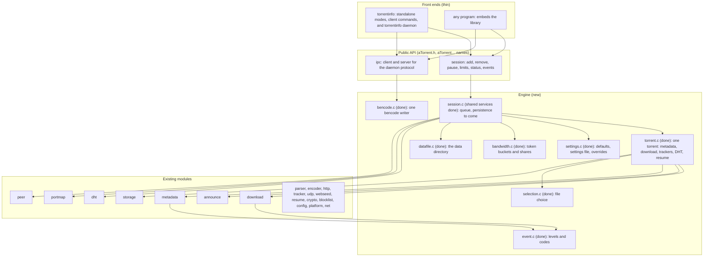
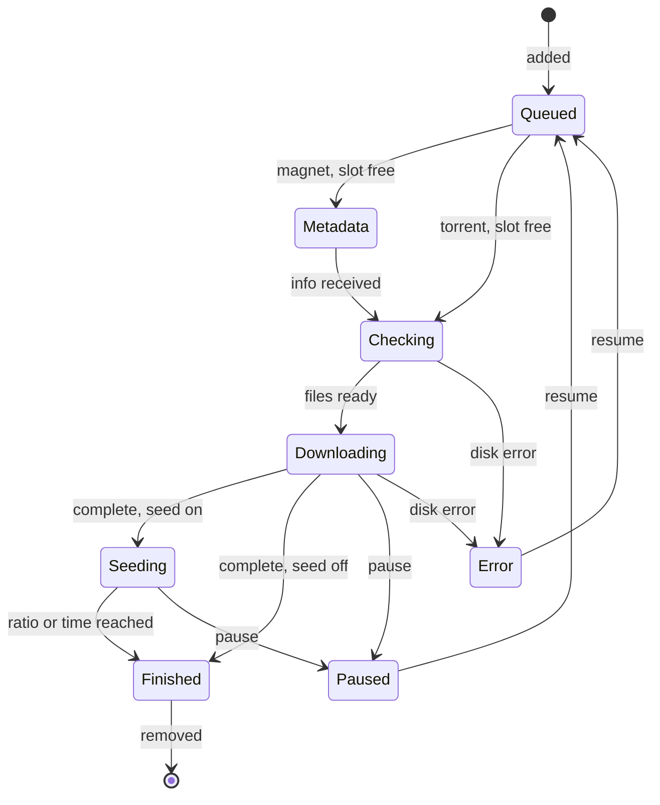

# libaTorrent — Design: a multi-torrent session, an embeddable API, a daemon and its CLI

*Written 14 November 2026; revised 26 November 2026 with the decisions in
section 10. Phases 0 to 2 are done (section 9); the rest is the plan. It builds on
ARCHITECTURE.md (read sections 2–5 and 12 first).*

## 1. Goals

1. **The library does the work; programs are thin.** Everything needed to
   download and seed torrents moves into the library:
   - finding peers (trackers, DHT, PEX);
   - port mapping and settings;
   - fast resume;
   - magnet links;
   - stopping cleanly.

   `torrentinfo` (the CLI, which also runs the daemon as
   `torrentinfo daemon`) and any other program become small front ends
   that parse arguments, call the library and show results.
2. **Embedding is simple.** A program should be able to add a torrent and
   watch it finish in about fifteen lines:
   - a program built around libuv puts the library on its own loop at no
     extra cost;
   - a program with another event loop (a GUI toolkit, say) lets the
     session own a loop and hands it control whenever it has work;
   - a program with no loop of its own just runs the session until done.

   Everything happens on one thread, so no program ever deals with locks.
3. **Many torrents at once.** One process runs any number of torrents,
   sharing:
   - one listening port;
   - one DHT node;
   - one port mapping;
   - global speed and connection limits;
   - a queue that decides which torrents are active.
4. **The daemon is just another user of the library.** It adds what a
   long-running service needs:
   - a control channel;
   - persistence of the torrent list;
   - service integration with the operating system.

   The same CLI talks to it while it runs.
5. **Nothing regresses.** At every step the existing program behaves as
   it does today, and the 24-check regression script passes on Linux
   (release, ASan, TSan) and on Windows under Wine.

## 2. Where the code is today

`main.c` is 3,600 lines and does far more than handle a command line.
Grouping its ~95 functions by what they really are:

| Group | Functions in `main.c` today | What they really are | Destination |
|---|---|---|---|
| Allocator | `trackingRealloc`, `trackingFree` | A leak-counting allocator | **Stays in the front ends** (the library already takes an allocator). |
| Data files | `readFile`, `writeFile`, `saveFile` (twice), `dataFilePath`, `resumeFilePath`, `magnetCachePath` | Paths in the data directory, whole-file read/write | **New `datafile.c`** in the library. *Done in Phase 0.* |
| Settings | `loadSettings`, `onSettingsWarning`, `loadBlocklist`, `isAbsolutePath`, `formatCount`, the globals `settingsFile`, `peerBlocklist`, `settingsMaxPeers`, `useDht`, `maxDownloadRate`, … | Merging defaults, the settings file and overrides; loading the blocklist | **New `settings.c`** (merging) and **`session.c`** (owning the result). No globals left. *`settings.c` and the globals done in Phase 0.* |
| File choice | `selecting`, `chooseFiles`, `globMatch`, `filePathText`, `lowerAscii` | Turning `1,3,5-7` and `*.mkv` into a per-file mask | **New `selection.c`**, returning errors instead of printing them. *Done in Phase 0.* |
| DHT lifetime | `startDht`, `stopDht`, `sockaddrFromDht`, `onDhtPeers`, `onDhtDone` | One DHT node, its saved state, feeding peers to a torrent | **`session.c`** (the node) and **`torrent.c`** (per-torrent lookups). *Done: the node in `session.c`, the lookups in `torrent.c` (Phase 2).* |
| Download orchestration | `downloadTorrent`, `onDownloadReady/Event/Complete/Finished`, `reportDownload`, `getAnnounceStats`, `onAnnouncePeers`, `onAnnounceResult`, `onPortmap`, `closeRun`, `stopRun`, `onTrackersStopped`, `downloadIsSeeding`, `downloadRun` | Running one torrent: download + announce + DHT + port mapping + clean stop | **New `torrent.c`** (per torrent) and **`session.c`** (shared services). *`torrent.c` done in Phase 1; the CLI keeps only the printing and the progress line.* |
| Magnet phase | `magnetTorrent`, `fetchRun`, `stopFetch`, `getFetchStats`, `onFetchPeers`, `onFetchDhtPeers`, `onFetchDhtDone`, `onFetchEvent`, `onFetchDone`, `onFetchTick`, `rememberPeer`, `parsePeerAddress` | Getting the metadata, then downloading | **`torrent.c`**, as the torrent's first state. *Done in Phase 1.* |
| Verify | `verifyTorrent`, `verifyRun`, `onVerifyOpen`, `onVerifyTick`, `pieceOverlap`, `percentOf` | Checking data and computing per-file results | **Library:** a `torrentVerify` result (per-file bytes, missing pieces). **CLI:** `printMissing` and the printing. |
| Create | `createTorrent`, `parsePieceLength`, `nameFromOutput`, `onCreated`, `printEncoderError` | Building a `.torrent` | **`encoder.c`** gains `encoderParsePieceLength`; the rest stays in the CLI. |
| Diagnostics | `announceTorrent`, `startAnnounces`, `onAnnounceDone`, `handshakePeers`, `peerRun`, `addPeer`, `settle`, `onHandshake`, `onMessage`, … | `-t` and `-P` probing tools | **Stay in the CLI** (they already use only public module APIs). |
| Output | `printTorrent`, `printEscaped`, `printField`, `printHex`, `formatSize`, `formatBytes`, `printFilePath`, `describeClient`, `formatPeer`, `printTrackerResult`, `onProgressTick`, `printMagnet`, `showMagnet`, `usage`, … | Text for people | **Stay in the CLI** (moved to `cli_format.c`). |
| Program plumbing | `nextOption`, `utf8Arguments`, `freeArguments`, `onInterrupt`, `main` | Arguments, signals | **Front-end code** (`cli_args.c`), used by the CLI and its `daemon` command. *The option parser's globals became a struct in Phase 0.* |

After the move, `main.c` (renamed `torrentinfo.c`) shrinks to roughly 800
lines: option parsing, output, the probing tools, and calls into the
session.

### What is already right

- **The modules below `main`** (download, storage, peer, announce, dht,
  portmap, metadata, …) are per-instance objects with clear lifetimes.
  `dht` already serves many torrents, and the incoming-connection router
  already dispatches by info hash.
- **Process-wide singletons exist in `peer`, `http`, `tracker` and
  `udp`.** Each is reference-counted per loop. One session per process
  keeps them correct. The design states that rule and leaves them alone
  (section 11 notes how to lift it later).

## 3. Target structure



### New modules

| Module | Purpose | Notes |
|---|---|---|
| `aTorrent.c` | The public entry points named in `aTorrent.h`. | **Done** (Phase 0): version and event names; the session API joins it in Phase 4. |
| `session.c` | The object an embedder creates. Owns the loop (or uses theirs), the shared listener, DHT node, port mapping, blocklist, settings, global limits, the queue, the torrent table, persistence and events. | The single entry point for embedders. **Shared services done** (Phase 2): `sessionBegin`/`AddTorrent`/`Stop`/`End`, one port, one DHT node, one port mapping, global limits, connection caps, one tick. The queue and persistence come in Phase 3. |
| `torrent.c` | One torrent from "added" to "removed": metadata fetch for magnets, file choice, download/seed, trackers, DHT lookups, resume, pause/resume, recheck, errors, statistics. | **Done** (Phase 1): `torrentBegin`/`torrentStop`/`torrentEnd`, structured callbacks (states, notices, events, trackers, DHT, port mapping, file choice, ready, complete, finished, ended) and `torrentGetStatus`. It still owns the DHT node, the tracker module and the listener, so one task per process until Phase 2; pause, resume and recheck come with the queue (Phase 3). |
| `settings.c` | A `settingsValues` struct: defaults, then the settings file (`config.c` stays the parser), then the caller's overrides; loading the settings file and the blocklist. | **Done** (Phase 0). Replaces `main.c`'s globals. |
| `selection.c` | `selectionSetList("1,3,5-7")`, `selectionAddPattern("*.mkv")`, `selectionApply(selection, torrent, mask, result)`. | **Done** (Phase 0). Errors come back as codes plus the numbers involved; nothing is printed. |
| `datafile.c` | Paths in the data directory (`dht.dat`, `resume/`, `torrents/`, later `session.dat`); reading and writing whole files, atomically when asked. | **Done** (Phase 0). |
| `bencode.c` | One bencode writer, into a fixed buffer or a growing one. Reading stays with `parserCursor`. | **Done** (Phase 0): `dht`, `extension`, `magnet` and `encoder` use it. The daemon protocol will too. |
| `event.c` | Levels (error, warning, info, debug) and codes for everything the engine reports, with the peer, piece or web seed concerned. | **Done** (Phase 0): `download` and `metadata` report through it. |
| `bandwidth.c` | Token buckets shared by many downloads: a global bucket plus optional per-torrent buckets, served round-robin. | **Done** (Phase 2), moved out of `download.c` (`rateLimit`). The session limit is divided every tick into *shares* for the downloads that are sending (section 6.2). |
| `ipc.c` | The daemon protocol: framing, a server on a `uv_pipe_t`, and a client usable both asynchronously and blocking. | Section 7. |

### Files and build

Keep `src/` flat for the library; put the front end in `src/tools/`:

```
src/              library (existing modules + new ones above)
src/aTorrent.h    the public header: aTorrent… functions, ATORRENT_API
src/tools/torrentinfo.c      the CLI (today's main.c, much smaller),
                             including "torrentinfo daemon"
src/tools/cli_args.c         options, UTF-8 arguments on Windows
src/tools/cli_format.c       sizes, rates, tables
tests/                       unit tests ("make check"; done in Phase 0)
examples/embed_loop.c        embedding on your own libuv loop
examples/embed_poll.c        embedding beside another event loop
```

- **Makefiles** (done in Phase 0): each of the three builds `libaTorrent.a`,
  the shared library (`libaTorrent.so.0` on Linux and FreeBSD,
  `libaTorrent.0.dylib` on macOS), `torrentinfo` and the unit tests.
- **Visual Studio** (done in Phase 0): `libaTorrent` (static,
  `libaTorrent.lib`), `libaTorrentDll` (`libaTorrent.dll` with the import
  library `libaTorrent.dll.lib`), `torrentinfo` and `check`.
- **Exports:** the shared libraries export only `ATORRENT_API` functions
  (`-fvisibility=hidden`; `__declspec(dllexport)` on Windows).
- **Installed headers:** `include/aTorrent/`: `aTorrent.h` plus, until the
  session API exists, the module headers.

## 4. The public API

### 4.1 Principles

- **Torrents are named by ID, not by pointer.** An `aTorrentTorrentId` is
  a 32-bit value: slot index plus a generation counter. IDs:
  - can't dangle;
  - can be kept by a program across calls;
  - are the same values the daemon protocol and the shared-memory
    statistics use.

  A stale ID returns `ATORRENT_ENOTFOUND`.
- **Everything is asynchronous underneath, but results come back
  simply.** Every call that changes state returns at once. The outcome
  arrives as an *event*, which can be delivered either way:
  - as a callback, from inside the loop;
  - queued, for programs that prefer to ask
    (`aTorrentSessionPollEvents`).
- **Status is a copy.** `aTorrentSessionGetTorrentStatus` fills a
  caller-owned struct, so nothing points into live state.
- **One thread** (section 5): every call is made on the thread that runs
  the loop, and every callback arrives there.
- **Names:** every public function starts with `aTorrent` and is marked
  `ATORRENT_API`; public types start with `aTorrent` and constants with
  `ATORRENT_`. The modules underneath keep their own prefixes
  (`download…`, `peer…`) and are not exported from the shared libraries.

### 4.2 Sketch of the session API in `aTorrent.h`

```c
/* Every function below is declared ATORRENT_API. */

/* ---- Creating a session ------------------------------------------------ */

typedef struct aTorrentSession aTorrentSession;
typedef uint32_t aTorrentTorrentId;          /* 0 is never a valid id */

typedef struct aTorrentSessionOptions {
    parserAllocator     allocator;          /* zero: malloc/free             */
    uv_loop_t          *loop;               /* NULL: the session makes its own */
    const char         *dataDirectory;      /* NULL: ~/.torrentinfo etc.     */
    const char         *settingsFile;       /* NULL: <data>/config; "" none  */
    aTorrentSettings     overrides;          /* applied after the file        */
    uint32_t            overrideMask;       /* which fields of 'overrides'   */
    uint8_t             persist;            /* keep the torrent list (daemon) */
    aTorrentEventCallback onEvent;           /* or NULL and poll              */
    void               *privateArg;
    aTorrentLogCallback  onLog;              /* NULL: no logging              */
    uint8_t             logLevel;
} aTorrentSessionOptions;

int32_t aTorrentSessionCreate(const aTorrentSessionOptions *options, aTorrentSession **session);

/* On the caller's loop: nothing more to do, uv_run() drives it.
 * On the session's own loop: run it until aTorrentSessionStop() completes. */
int32_t aTorrentSessionRun(aTorrentSession *session);

/* Beside another event loop: wait until the descriptor is readable or the
 * timeout (ms, -1: none) passes, then do whatever is due without blocking.
 * (libuv has no such descriptor on Windows: call RunOnce from a 10-50 ms
 * timer there.) */
int     aTorrentSessionBackendFd(aTorrentSession *session);
int32_t aTorrentSessionBackendTimeout(aTorrentSession *session);
void    aTorrentSessionRunOnce(aTorrentSession *session);

/* Stop everything cleanly: final resume saves, "stopped" to trackers,
 * port mapping removed, DHT table saved. 'done' runs once, then
 * aTorrentSessionDestroy() may be called. */
void    aTorrentSessionStop(aTorrentSession *session, void (*done)(void *arg), void *arg);
void    aTorrentSessionDestroy(aTorrentSession *session);

/* ---- Torrents -------------------------------------------------------- */

typedef struct aTorrentAddOptions {
    const char     *saveDirectory;          /* NULL: settings default        */
    const char     *fileList;               /* "1,3,5-7" or NULL             */
    const char *const *filePatterns;        /* "*.mkv", ... NULL-terminated  */
    uint8_t         paused;                 /* add without starting          */
    uint8_t         seed;                   /* keep seeding when complete    */
    double          seedRatio;              /* stop seeding at this, 0: never */
    uint32_t        seedMinutes;            /* ...or after this, 0: never    */
    uint64_t        maxDownloadRate;        /* per torrent; 0: global only   */
    uint64_t        maxUploadRate;
} aTorrentAddOptions;

int32_t aTorrentSessionAddTorrentFile(aTorrentSession *s, const char *path,
                              const aTorrentAddOptions *o, aTorrentTorrentId *id);
int32_t aTorrentSessionAddTorrentData(aTorrentSession *s, const uint8_t *data, size_t length,
                              const aTorrentAddOptions *o, aTorrentTorrentId *id);
int32_t aTorrentSessionAddMagnet(aTorrentSession *s, const char *link,
                         const aTorrentAddOptions *o, aTorrentTorrentId *id);

int32_t aTorrentSessionPause(aTorrentSession *s, aTorrentTorrentId id);
int32_t aTorrentSessionResume(aTorrentSession *s, aTorrentTorrentId id);
int32_t aTorrentSessionRecheck(aTorrentSession *s, aTorrentTorrentId id);       /* like -R  */
int32_t aTorrentSessionRemove(aTorrentSession *s, aTorrentTorrentId id, uint8_t deleteFiles);
int32_t aTorrentSessionSetFiles(aTorrentSession *s, aTorrentTorrentId id, const uint8_t *wanted);
int32_t aTorrentSessionSetTorrentLimits(aTorrentSession *s, aTorrentTorrentId id,
                                uint64_t down, uint64_t up);
int32_t aTorrentSessionMoveQueue(aTorrentSession *s, aTorrentTorrentId id, int32_t position);

/* ---- Session-wide ---------------------------------------------------- */

int32_t aTorrentSessionSetLimits(aTorrentSession *s, uint64_t down, uint64_t up);
int32_t aTorrentSessionApplySettings(aTorrentSession *s, const aTorrentSettings *settings,
                             uint32_t mask);                  /* live change */
int32_t aTorrentSessionReloadBlocklist(aTorrentSession *s);

/* ---- Looking ------------------------------------------------------------- */

typedef enum aTorrentState {
    ATORRENT_STATE_QUEUED, ATORRENT_STATE_METADATA, ATORRENT_STATE_CHECKING,
    ATORRENT_STATE_DOWNLOADING, ATORRENT_STATE_SEEDING, ATORRENT_STATE_PAUSED,
    ATORRENT_STATE_FINISHED, ATORRENT_STATE_ERROR
} aTorrentState;

typedef struct aTorrentTorrentStatus {
    aTorrentTorrentId id;
    aTorrentState     state;
    char             name[256];             /* truncated if longer           */
    uint8_t          infoHash[20];
    uint64_t         size, done, uploaded, downloaded, wasted;
    uint64_t         downloadRate, uploadRate;      /* bytes/s, smoothed     */
    uint32_t         pieces, piecesDone, checkingDone, checkingTotal;
    uint32_t         peers, seeds, peersEncrypted, webSeeds;
    double           ratio;
    int64_t          eta;                   /* seconds, -1 unknown           */
    char             error[160];
} aTorrentTorrentStatus;

int32_t  aTorrentSessionGetTorrentStatus(aTorrentSession *s, aTorrentTorrentId id,
                                 aTorrentTorrentStatus *status);
uint32_t aTorrentSessionListTorrents(aTorrentSession *s, aTorrentTorrentId *ids, uint32_t max);
int32_t  aTorrentSessionGetStatus(aTorrentSession *s, aTorrentSessionStatus *status);   /* totals    */
uint32_t aTorrentSessionGetPeers(aTorrentSession *s, aTorrentTorrentId id, aTorrentPeerInfo *peers,
                         uint32_t max);
uint32_t aTorrentSessionGetFiles(aTorrentSession *s, aTorrentTorrentId id, aTorrentFileInfo *files,
                         uint32_t max);

/* ---- Events ---------------------------------------------------------- */

typedef enum aTorrentEventType {
    ATORRENT_EVENT_ADDED, ATORRENT_EVENT_METADATA, ATORRENT_EVENT_STATE,
    ATORRENT_EVENT_COMPLETED, ATORRENT_EVENT_ERROR, ATORRENT_EVENT_REMOVED,
    ATORRENT_EVENT_TRACKER, ATORRENT_EVENT_PORT_MAPPED, ATORRENT_EVENT_STOPPED
} aTorrentEventType;

typedef struct aTorrentEvent {
    aTorrentEventType type;
    aTorrentTorrentId torrent;               /* 0 for session-wide events     */
    int32_t          status;                /* ATORRENT_OK or an error code   */
    const char      *message;               /* for people; valid in the call */
} aTorrentEvent;

/* Programs that prefer to ask: up to 'max' events since the last call. */
uint32_t aTorrentSessionPollEvents(aTorrentSession *s, aTorrentEvent *events, uint32_t max);
```

### 4.3 Embedding: three examples

**On your own libuv loop** (zero overhead):

```c
uv_loop_t               loop;
aTorrentSession        *s;
aTorrentSessionOptions  o = { 0 };
aTorrentTorrentId       id;

uv_loop_init(&loop);
o.loop = &loop;
o.onEvent = onEvent;                        /* COMPLETED: aTorrentSessionStop() */
aTorrentSessionCreate(&o, &s);
aTorrentSessionAddMagnet(s, "magnet:?xt=urn:btih:...", NULL, &id);
uv_run(&loop, UV_RUN_DEFAULT);              /* returns once stopped             */
aTorrentSessionDestroy(s);
```

**With no loop of your own** (the session owns one and runs until an
event handler stops it):

```c
aTorrentSessionOptions o = { 0 };

o.onEvent = onEvent;                        /* COMPLETED: aTorrentSessionStop() */
aTorrentSessionCreate(&o, &s);
aTorrentSessionAddTorrentFile(s, "ubuntu.torrent", NULL, &id);
aTorrentSessionRun(s);                      /* returns once stopped             */
aTorrentSessionDestroy(s);
```

**Beside another event loop** (a GUI toolkit; `watchDescriptor` and
`addTimeout` stand for that toolkit's calls):

```c
aTorrentSessionCreate(&o, &s);              /* the session owns a libuv loop    */
aTorrentSessionAddTorrentFile(s, "ubuntu.torrent", NULL, &id);
watchDescriptor(aTorrentSessionBackendFd(s), onSessionReady, s);
addTimeout(aTorrentSessionBackendTimeout(s), onSessionReady, s);
/* ... the toolkit's loop runs ... */

static void onSessionReady(void *arg)
{
    aTorrentSessionRunOnce(arg);            /* never blocks                     */
    addTimeout(aTorrentSessionBackendTimeout(arg), onSessionReady, arg);
}
```

In all three, `aTorrentSessionGetTorrentStatus` can be called at any time
from the same thread, for example from a GUI's redraw.

## 5. One thread

The engine is single-threaded, as today, and the API keeps it that way:

- **Every call runs on the loop's thread,** and every callback and event
  arrives there. There are no locks, no command queue and no snapshots:
  a status call copies from live state.
- **libuv's thread pool still does the blocking work** (hashing, checking
  files, resume saves, DNS lookups), exactly as today. Those jobs never
  touch session state: they hand their results back to the loop, as the
  resume code already does (encoded on the loop thread, sealed and written
  on a worker). Neither the library nor the program sees these threads.
- **The allocator need not be thread-safe,** because only the loop thread
  allocates. The counting allocator in the front ends stays as it is.
- **Programs with threads of their own** hand work to the loop thread
  themselves (`uv_async_send`), as with any libuv library. Debug builds
  can catch mistakes: the session records its thread (`uv_thread_self`) and
  every public call checks it.
- **Stopping** is `aTorrentSessionStop`, which runs the same clean
  shutdown `main` does today and then lets `uv_run` return.

A thread facade (calls from any thread, with a command queue and status
snapshots) was considered and left out (decision 4). Nothing in the design
prevents adding one later as a separate layer.

## 6. Engine changes for many torrents

### 6.1 One listening port

Today each download opens its own listeners. The session opens them once
(IPv4 and IPv6) and routes incoming connections:
- **Plain connections:** by the info hash in the handshake (exists today).
- **Encrypted connections:** the router needs every active torrent's info
  hash. Replace the fixed array of 16 hashes
  (`peerListenerAddInfoHash`) with a lookup callback,
  `peerListenerSetHashLookup(listener, fn, arg)`. The session answers it
  from its torrent table, keyed by `SHA1("req2", hash)`. *Done (Phase 2):
  the table is searched in order, which is ample for hundreds of torrents;
  a hash table can come later.*
- **Torrents** register and unregister with the session; `downloadBegin`
  gains an option to *not* listen and accept connections handed to it
  (`downloadAcceptIncoming`). *Done.*

### 6.2 Global limits

- **Bandwidth.** `bandwidth.c` keeps a session bucket (from the global
  limits) and optional per-torrent buckets. A request or upload block must
  pass both. *Done (Phase 2), as shares rather than round-robin serving:
  every tick the session refills its bucket, takes back what the shares
  did not use, and divides the rest equally among the downloads that sent
  something or wanted to. One busy torrent can use the whole limit, two
  split it evenly (tested: when one of two equal torrents finishes, the
  other has more than three quarters), and an idle one costs nothing.*
- **Connections.** A global maximum of open peer connections (500, say)
  and of half-open attempts (30). The session hands out connection
  "tickets" that downloads request before calling `peerConnect`. *Done as a
  gate (`downloadGate`) the download asks before each connection, incoming
  or outgoing; defaults 500 and 30.*
- **Upload slots.** At first each torrent keeps its own 4 slots, with the
  total capped. Later, a session-wide rechoke could pick the best
  reciprocating peers across all torrents. *Each torrent keeps its own 4
  slots; the total cap is left for Phase 3 with the queue, which decides
  how many torrents are active at all.*

### 6.3 One timer instead of hundreds

At 100 ms, a timer per download is fine for tens of torrents but wasteful
for thousands. The session runs one 100 ms tick. Each active download
exposes `downloadTick(dl, now)`, which is today's `onTick` body, made
callable. Idle (paused or queued) torrents cost nothing. *Done
(`downloadTick`, with `externalTick` in the download options).*

### 6.4 Shared services

- **DHT:** one node for the whole session (`dhtAddTorrent` per torrent
  already works). The saved state moves from `main.c` to the session.
  *Done.*
- **Port mapping:** one `portmap` per session, for the shared port. *Done.*
- **Trackers:** `announce` stays per torrent, and all torrents share the
  HTTP and UDP modules. A session-wide limit on concurrent announces (say
  20) stops a restart with 1,000 torrents from flooding trackers. *The
  tracker module is now shared and reference-counted, and each announce
  carries the session's port; the announce limit comes with the queue
  (Phase 3).*
- **Blocklist and settings:** loaded once and shared by pointer. A reload
  builds the new copy, swaps the pointer and frees the old copy, all on the
  loop thread, so nothing can be reading it at the time.
- **The thread pool:** checking many torrents at start-up competes with
  DNS. The session limits concurrent checks (one or two torrents
  checking at a time, which fast resume makes rare). It also raises
  `UV_THREADPOOL_SIZE`, for example to 8, before the loop does any work,
  when it owns the loop. *Both with the queue (Phase 3) and the session
  owning its loop (Phase 4).*

### 6.5 The queue

States:



- **Active limits:** at most `max_active_downloads` torrents in
  Metadata, Checking or Downloading, and at most `max_active_seeds`
  seeding. When one finishes or pauses, the next queued torrent starts.
- **Pausing** is implemented as ending the download and the announce:
  the final resume save, then `stopped` sent to trackers. Resuming starts
  them again, and fast resume makes that instant. This reuses tested
  paths instead of adding a "frozen" state to the download.
- **Removing** stops the torrent, deletes its resume file and cached
  `.torrent` and, if asked, its data files. That needs a new
  `storageDeleteFiles` on the thread pool.

### 6.6 Persistence

`session.dat` in the data directory, written atomically (bencoded, `.tmp`
plus rename) whenever the torrent list changes. It holds, per torrent:
- info hash, name and save directory;
- file selection and state (paused or not);
- queue position;
- limits and seeding goals;
- time added and total uploaded/downloaded (for ratios across restarts).

The torrent's metadata is kept in `torrents/<hash>.torrent`, as magnets
already do. A restart therefore needs only `session.dat`, the `.torrent`
files and the resume files: no re-checking, no fetching metadata again.

### 6.7 Events and logging instead of printing

- **Done for downloads and metadata fetches (Phase 0):** every report is
  an `eventInfo` with a level (error, warning, info, debug), a code
  (`EVENT_PEER_CONNECTED`, `EVENT_PIECE_FAILED`, …), the readable message,
  and the peer, piece or web seed it concerns. No library module prints.
- **Still to do:** the session adds the torrent ID, and maps
  `onComplete`/`onFinished` to session events.
- **Formatting:** the front ends decide what to print. The CLI keeps its
  current output exactly by printing the same messages.

## 7. The daemon, `torrentinfo daemon`

### 7.1 What it does

It is the CLI's `daemon` command: one process, one thread, with libuv
handling every event. In the first release it runs in the foreground on
every system, until Ctrl-C, `SIGTERM` or a `daemon stop` request (libuv
turns Ctrl-C into `SIGINT` on Windows too, so shutdown is one code path).
Detaching and a Windows service come later (7.4).

1. Parses its few options:
   - `--data-dir`;
   - `--socket` (or the named pipe name);
   - `--log-file`;
   - `--no-stats-shm`.
2. Takes a **single-instance lock**: a lock file with `flock` /
   `LockFileEx`, holding the pid.
3. Creates a session with `persist = 1`. It loads `session.dat` and
   resumes torrents.
4. Opens the **control server** (section 7.2) and, in a later phase, the
   **shared-memory statistics** (ARCHITECTURE.md §12.3).
5. Runs the loop until asked to stop by:
   - a control command;
   - `SIGTERM` or `SIGINT` (Ctrl-C, on Windows as well).

   Then `aTorrentSessionStop` performs the clean shutdown that `main` does today.
6. Logs to a file, to `syslog`, or to the Windows Event Log, through the
   session's log callback.

### 7.2 The control channel

**Transport:** `uv_pipe_t` everywhere.
- **Linux, FreeBSD, macOS:** a UNIX domain socket.
  - Location: `$XDG_RUNTIME_DIR/torrentinfo.sock`, falling back to
    `<data>/daemon.sock`.
  - Permissions `0600`, with the directory `0700`.
- **Windows:** a named pipe, `\\.\pipe\torrentinfo-<user SID>`, with a
  security descriptor allowing only the current user.

libuv supports both natively, so the server is one code path.

**Framing:** a 4-byte big-endian length, then one **bencoded dictionary**
(at most 16 MiB). Bencode is already the project's format:
- the parser and writer exist;
- it is binary-safe (a whole `.torrent` file can be sent as a value);
- it is compact;
- the DHT already uses this request/reply style (KRPC).

No JSON library is needed. A JSON gateway could be added later for web
front ends.

**Messages:**

```
request: d1:q3:add1:t4:\x00\x00\x00\x01 1:a d...arguments... e e
reply:   d1:t4:\x00\x00\x00\x01 1:r d...results...      e e
error:   d1:t4:\x00\x00\x00\x01 1:e l i404e 9:not found  e e
event:   d1:v5:state 1:a d 2:id i7e 5:state 8:seeding    e e   (only to subscribers)
```

| Request (`q`) | Arguments (`a`) | Result (`r`) |
|---|---|---|
| `hello` | protocol version, client name | daemon version, session id, capabilities |
| `add` | `torrent` (raw bytes) *or* `magnet` *or* `path`; options as in `aTorrentAddOptions` | `id` |
| `remove` | `id`, `delete` | — |
| `pause` / `resume` / `recheck` | `id` (or `all`) | — |
| `files` | `id`, `wanted` (list) | — |
| `limits` | session or `id`; `down`, `up` | — |
| `list` | optional filter by state | list of status dictionaries |
| `status` | `id` | status, files, trackers, peers (optional) |
| `stats` | — | session totals |
| `settings` | optional changes | current settings |
| `subscribe` | event types | — (events then follow) |
| `shm` | — | the shared-memory name and layout version |
| `shutdown` | — | — (the daemon stops cleanly) |

**Robustness:**
- Every request is validated before it reaches the session: types,
  lengths, ID ranges.
- A malformed frame closes that client only.
- A client that doesn't read its events is dropped once its outgoing
  buffer exceeds a limit (say 1 MiB), so it can't make the daemon grow
  without bound.
- Request IDs (`t`) let a client pipeline requests.

**The client side** is in the library too (`ipc.c`), so any program can
drive a running daemon:
- `ipcConnect(path, &client)`;
- `ipcRequest(client, "add", args, callback)` (asynchronous);
- `ipcRequestWait(...)` (blocking);
- a small typed layer: `ipcAddTorrentFile`, `ipcList`, …

### 7.3 Statistics in shared memory

As designed in ARCHITECTURE.md §12.3–12.4: header, session block, torrent
table, top peers and event ring. Each record has a seqlock, and the
daemon refreshes records every 100 ms from live state, on the loop thread.
Clients learn the mapping's name from the `shm` request.

This is what makes a live dashboard (`torrentinfo watch`) cost the daemon
nothing, however often it redraws. It is a later phase: the control
channel's `list` and `status` cover everything first.

### 7.4 Running as a service (later)

The first release is a plain foreground process on every system (decision
5), which is already what systemd and launchd want. Later:

| System | How | Stop |
|---|---|---|
| Linux | systemd user unit `torrentinfo.service` running `torrentinfo daemon` (`Type=simple`, or `notify` via `sd_notify`) | `SIGTERM` |
| FreeBSD | `rc.d/torrentinfo` with `daemon(8)` | `SIGTERM` |
| macOS | launchd agent `~/Library/LaunchAgents/org.torrentinfo.daemon.plist` | `SIGTERM` |
| Windows | a per-user process started at log-on; a real service (`StartServiceCtrlDispatcher`) only if running without anyone logged in is wanted | `daemon stop`, or service control `STOP` → `uv_async_send` → `aTorrentSessionStop` |

`--detach` (fork, `setsid`) can then be offered on POSIX for people
starting it by hand.

## 8. The CLI

`torrentinfo` keeps every standalone mode it has today:
- inspect, `-o`, `-t`, `-P`, `-m`, `-V`;
- `-D`, which becomes a session with one torrent, running in the
  foreground.

It gains client commands that talk to a running daemon:

```
torrentinfo add file.torrent [-O dir] [-f list] [-F glob] [--paused]
torrentinfo add "magnet:?xt=..."
torrentinfo list                     # one line per torrent
torrentinfo status 7                 # details: files, trackers, peers
torrentinfo pause 7 | resume 7 | recheck 7 | remove 7 [--delete]
torrentinfo limits [7] -d 2M -u 500k
torrentinfo watch                    # live view (events, later shared memory)
torrentinfo daemon                   # run the daemon here; Ctrl-C stops it
torrentinfo daemon stop | status
```

- **Telling commands from files:** a first argument that is one of these
  words is a command. Anything else is treated as today, so existing
  scripts keep working. A file actually called `list` can be given as
  `./list`.
- **Errors:** if no daemon is running, client commands say so and
  suggest starting one with `torrentinfo daemon`.
- **Output:** client commands print with the same `cli_format.c` code as
  `-D`, so both look alike.

`-D` becomes ~40 lines on the session API, and gets multi-torrent
`-D a.torrent b.torrent` for free.

## 9. The plan, step by step

Each phase is a working program with the regression script passing (Linux
release, ASan, TSan; Windows under Wine), plus the new tests listed.

| Phase | Work | New tests | Size |
|---|---|---|---|
| **0. Groundwork** — **done** 26 Nov 2026 | The library renamed `libaTorrent` (static and shared, `aTorrent.h`, `ATORRENT_API`, hidden internals); `bencode.c` (`dht`, `extension`, `magnet` and `encoder` use it); `datafile.c`; `selection.c`; `settings.c`; `event.c` levels and codes in place of `emit()` strings; `main.c`'s globals removed (the leak counter and a constant tag stay); `make check`. | 160 unit checks (bencode exact output and 2,000-value fuzz; a three-node DHT on loopback; selection; settings precedence and blocklist rules; data files), passing on Linux (release, ASan+UBSan, TSan), FreeBSD (built with bmake) and Windows (Wine). Regression 24/24 on Linux release, ASan, TSan and Windows. | Medium |
| **1. `torrent.c`** — **done** 26 Nov 2026 | `downloadTorrent` and `magnetTorrent` (with announce, DHT lookups, port mapping, resume and stopping) moved into a torrent task; both phases of a magnet link on one loop, sharing the DHT node and the tracker module (new `trackerSetPort`, `trackerPeerAddress`). `main.c` down to 2,800 lines: printing, progress and signals. | Regression 24/24 on Linux (release, ASan, TSan) and Windows; Phase 0 and Phase 1 output compared scenario by scenario (every early end, Ctrl-C while fetching, seeding, a second Ctrl-C while trackers are told): identical apart from timing. New unit suite: a seed task and a magnet-link download on loopback, the kept torrent used next time, and each early end (212 checks, also under ASan, TSan and Windows). | Large |
| **2. `session.c`** — **done** 27 Nov 2026 | Shared listener with hash lookup, one DHT, one port mapping, `bandwidth.c` global limits, connection caps (a gate), one tick. `-D` accepts several torrents. Torrent tasks now borrow the session's services. On the way: new downloads request again as soon as a checked piece frees its place (our client seeding to itself went from 80 KiB/s to over 100 MB/s with small pieces), and peers that refused the handshake are retried. | Unit tests over loopback with two sessions: two torrents on one port with plain and with encrypted connections; a 1 MiB/s session limit split fairly between two torrents; 100 small torrents at once; a magnet link and its kept torrent; every early end (464 checks, also under ASan, TSan, on Windows and with the FreeBSD makefile). Regression 24/24 on Linux release, ASan, TSan and Windows. | Large |
| **3. Queue and persistence** | States, active limits, pause/resume/recheck/remove (with deletion), `session.dat`, seeding goals. | Restart restores everything without re-checking; queue order; removal cleans files. | Medium |
| **4. Embedding** | The session API in `aTorrent.h`; `aTorrentSessionPollEvents`; backend descriptor and `RunOnce`; the wrong-thread check in debug builds; `examples/`. | Examples built and run in CI, one of them driving the session from a `poll()` loop of its own; the shared libraries export exactly the API. | Medium |
| **5. Daemon and client** | `ipc.c` (server and client), `torrentinfo daemon`, client commands in `torrentinfo`, single-instance lock, logging. | Protocol fuzzing (random frames); a client dying mid-request; slow subscribers dropped; daemon restart; Windows named pipes under Wine. | Large |
| **6. Shared-memory statistics** | The mapping, seqlocks, the platform functions (`platformSharedCreate`, atomics), `torrentinfo watch`. | A reader hammering the mapping under TSan; version mismatch refused. | Medium |
| **7. Service integration** | Detaching; systemd, rc.d, launchd, Windows start-up (and a service, if wanted); packaging. | Start/stop through each service manager (manual on FreeBSD and macOS until those systems are run for real). | Small–medium |

Phases 0–2 are worth doing even without a daemon:
- they make the library usable on its own;
- they shrink `main.c` to a front end;
- they give the CLI multi-torrent downloads.

## 10. Decisions (26 November 2026)

1. **Names.** The library is **aTorrent**: `libaTorrent.a`,
   `libaTorrent.so`, `libaTorrent.dylib`, `libaTorrent.dll` (with
   `libaTorrent.lib` for static Windows builds and `libaTorrent.dll.lib` as
   the DLL's import library). Every public function starts with `aTorrent`.
   The modules underneath keep their own prefixes and are hidden in the
   shared libraries.
2. **One CLI:** `torrentinfo`, with the client commands of section 8 and
   the daemon as `torrentinfo daemon`.
3. **Protocol:** a simple bencoded format (section 7.2).
4. **One process and one thread,** with libuv managing all event
   processing. No thread facade (section 5).
5. **A plain foreground process** on Linux and Windows (and FreeBSD and
   macOS) to begin with; daemonising and services later (section 7.4).

## 11. Risks and how to handle them

- **Moving `main.c` breaks behaviour subtly.** Phase 1 changes no
  behaviour, only where code lives. The regression script and identical
  output are the gate.
- **Process-wide singletons** (`peer`, `http`, `tracker`, `udp`) allow one
  session per process. That is fine for the daemon and nearly every
  embedder. If two sessions in one process are ever needed, the
  singletons become fields of the session; their reference counting
  already isolates them by loop.
- **Calls from the wrong thread:** a program with threads of its own might
  call the session from one of them. The API documents the rule, and
  debug builds check it on every public call (section 5).
- **Name clashes with the static library:** the shared libraries export
  only `aTorrent…` names, but `libaTorrent.a` cannot hide the internal
  ones (`peerConnect`, `storageOpen`, …), which could clash with a
  program's own. If that is ever reported, the internal names can be
  given a prefix mechanically.
- **Many torrents and the thread pool:** checks and disk I/O can starve
  DNS. Section 6.4 limits concurrent checks and enlarges the pool. A
  dedicated disk queue (ARCHITECTURE.md §11.2) is the long-term fix.
- **Control socket security:** the socket/pipe is owner-only. Remote
  control (TCP) is deliberately left out until there is authentication
  and TLS.
- **FreeBSD and macOS** still haven't been run. The daemon adds
  per-platform code (lock files, service glue, `XDG_RUNTIME_DIR`), so
  real runs on those systems become more important before calling the
  daemon supported there.
